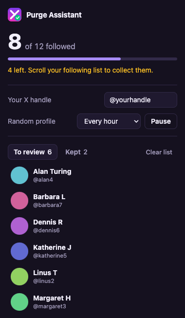

# X Purge Assistant

Chrome extension to prune your X following list: mark accounts you want to **Keep**, unfollow the rest.

## Use

1. Load unpacked at `chrome://extensions` (Developer mode), then refresh x.com.
2. Enter your handle in the popup. Nothing runs until it is set.
3. Open `x.com/<handle>/following` and scroll to collect your list. The popup shows tracked vs X's reported total.
4. Click **Keep** next to accounts you want to keep. Unfollow the rest on X.
5. Optional: set an interval to have a random non-kept account opened in a new tab every so often (±25%).

Everything is stored locally in your browser. Nothing is sent anywhere.

## Disclaimer

Unofficial project, not affiliated with or endorsed by X Corp. It reads X's unofficial web responses and page markup, so it can break whenever X changes them. Automated activity may conflict with X's terms of service. Use at your own risk.

## License

[MIT](LICENSE)
